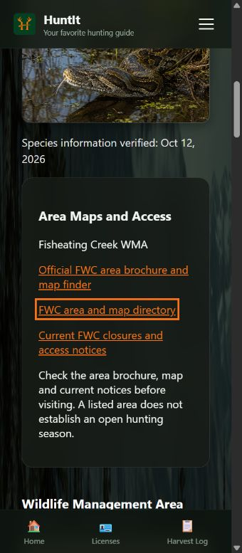
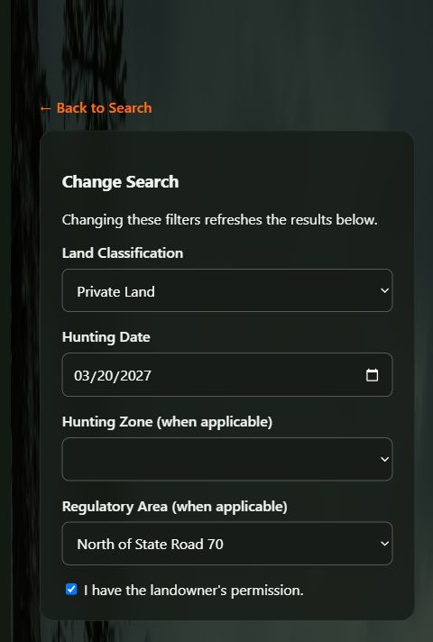

# HuntIt data completion and WMA expansion

Prepared October 12, 2026. Nothing committed or pushed.

**Source-link cleanup:** the distributed setup and approved original-data fixtures now omit non-regulatory map-link tracking. Regulatory content and approval dates remain the same; existing installations retain their history and withdrawal decisions. See [SOURCE_LINK_CLEANUP.md](SOURCE_LINK_CLEANUP.md).

**Fresh-install startup correction:** the local launcher now disables Angular's first-run prompts, displays labeled server output, and waits for both ports before announcing readiness. The data and approved releases are unchanged. See [STARTUP_FIX_REPORT.md](STARTUP_FIX_REPORT.md) for the observed failure and the focused changes, and [INTEGRATION.md](INTEGRATION.md) for startup instructions.

## What was added

This update completes the dataset for the four existing species within the supported dates and locations, and expands selected public-land coverage using official FWC material. The project owner checked the sources and approved local publication on October 12, 2026: **“Sources checked — approve local publication.”** This update contains **40 new scopes and 18 revisions**, for **58 approved current scopes and 268 explicit date periods**. The two public-land selectors repeat each area's rules; they do not represent extra areas. The original 102 imported season records, both earlier approved release files and all previous publication revisions remain intact.

| Coverage | Additions |
|---|---|
| Private turkey | Four fall-zone scopes and two spring/youth SR70 scopes: exact 2026-2027 dates, permits/exemptions, lawful methods, bags, shooting hours, youth supervision, harvest reporting and completion of blank species background fields. |
| Existing deer, hog and python | Approved revisions add missing general equipment, exemption, shooting-hour, access/closure and public-python Executive Order qualifications. Existing reviewed dates are preserved. |
| Corbett, Holey Land, Rotenberger and Dinner Island Ranch | All four species are represented, including explicit turkey prohibitions at Holey Land/Rotenberger. Added area-specific dates, bags, methods, quota/vehicle requirements and access conditions. Existing Corbett deer coverage is reused. Dinner Island's separately regulated Caracara Unit is excluded. |
| Fisheating Creek python | Separate east/west US27 selectors. East requires the special-opportunity permit and the two exact March 2027 hunt periods. West's year-round methods exclude firearms, airguns, bows and crossbows; seasonal weapon use remains conditional, with a management-area permit when using a gun. |
| Reference catalog | Added Turkey Permit; filled blank working permit details and official brochure/finder and map-directory links for all 32 existing managed areas. Existing nonblank teammate values are preserved. No guessed coordinates or acreage were added. |

The dataset remains scoped to the documented areas and dates; it is not an exhaustive database of every Florida WMA. Maps and notices link to FWC. This application does not continuously fetch live closures or submit official harvest reports.

## Changes to the existing code

The original backend models, migrations, imports and dependency file were not rewritten. New data factories and the frozen approved-release loader live in the separate `backend/integration/` app. Setup runs `load_approved_expansion` after the two earlier release loaders. It checks all 58 scopes before installing them atomically; a working payload, title, species or land-type conflict stops the whole expansion installation without overwriting team edits. Later reviewed publications and withdrawals are preserved, and a receipt prevents replay. Future edits require a new review.

The existing integration engine now evaluates weekday restrictions and explicit prohibitions. Corbett's spring turkey hunt therefore stays closed on excluded weekdays. Approved publications complete blank turkey profile fields without allowing mutable data to inherit old approval. A narrowly scoped guard prevents the known-overbroad historical Fisheating python answer from resurfacing; the approved east/west replacements now supply precise answers. Frozen history and original supplemental records are retained.

Changes to the Angular code are confined to Home/Results and shared regulation types: show only applicable regulatory-area choices, clear incompatible selections, and display official brochure/map/closure links. The new links use the existing orange color so they remain readable on the dark mobile layout. Original artwork and stylesheets were preserved.

Main implementation files: `backend/integration/turkey_data.py`, `wma_data.py`, `extra_wma_data.py`, `python_area_data.py`, `catalog_data.py`, `data_expansion.py`, `public_scope_guards.py`, and the small engine/model/service/admin/view hooks. Exact comparison with both original ZIPs is in [CHANGE_MANIFEST.json](CHANGE_MANIFEST.json).

## Human review and publication

**The new content is human-approved for publication in the local app and shared ZIP.** The PDF section 1.2.4 requires source review before publication. The separate owner approval covers this exact expansion; neither earlier approval was reused. The approval was recorded at **2026-10-12 21:44:55 UTC**, without claiming that this is the exact message-send time. No administrator account or credential is bundled, and nothing was committed or pushed.

The [original exact-content pack](DATA_EXPANSION_REVIEW.md) and its [JSON](DATA_EXPANSION_REVIEW.json) preserve the reviewed regulatory content. The distributed documentation uses neutral team wording; approval statements and dates are retained. Their historical pending-status wording describes the pack when submitted for review; [DATA_EXPANSION_APPROVAL.md](DATA_EXPANSION_APPROVAL.md) records the subsequent approval and the frozen release. The reviewed JSON is pinned to SHA-256 `f54de4a3edbf240c5c20f8f6fc88fcb054dc64053dc227b544d2fc48d239374c`. Supporting source worksheets cover [turkey](sources/TURKEY_REVIEW.md), [three WMAs](sources/WMA_REVIEW.md), [Dinner Island](sources/EXTRA_WMA_REVIEW.md) and [Fisheating](sources/FISHEATING_PYTHON_REVIEW.md). Python firearm permissions remain limited by each brochure's open seasons, allowed methods, species and access provisions; the summaries do not grant a blanket spring-turkey firearm exception.

Normal setup installs the two earlier approved releases and the newly approved expansion. A fresh database has **58 current curated publications, 76 curated publication revisions in total, one current frozen original-data publication and three installation receipts**, with zero bundled accounts. The new WMA answers, completed turkey requirements/profile and Fisheating replacements are available to guest searches. Later imports or draft edits do not inherit this approval, and withdrawn answers are not restored by setup.

## QA

After publication, **229 Django tests and 64 Angular tests passed**. The approved-default API matrix covered **782 requests**, every scope's period boundaries, exact geographic matching, weekday restrictions, prohibited hunts, youth conditions, sources and immutable revision history. Production build and Django schema/system checks passed. Two pre-existing CSS size warnings remain. Fourteen new tests check frozen approval, portable IDs, conflict rollback, later reviews, withdrawals and repeat setup.

Live browser checks used a disposable QA database with test-only publications: completed turkey guidance and SR70 choices; Corbett closed on Monday; Fisheating east permit/side choices and closure after its hunt; Dinner Island small-game hog exemption and methods; mobile layout at 355 by 812 with no horizontal overflow. The new reference-link color was corrected and visually rechecked. Test reviewer accounts and publications are excluded from the ZIP. See [QA_REPORT.md](QA_REPORT.md) for release verification.

The real local database now contains all 58 approved current scopes and preserves all 18 earlier revisions unchanged. Repeated setup added nothing. Post-publication browser checks confirmed completed turkey requirements/profile, the precise Fisheating permit and closing date, Corbett's weekday closure and Holey Land's turkey prohibition. No reviewer account or shared credentials were created.

Independent verification of the approved data-release ZIP passed before the later launcher correction: **212 clean packaged files**, fresh extracted migration/seed/repeated-seed checks, no schema drift and valid SQLite with zero foreign-key errors. Fresh setup reproduced all 58 approved current scopes, 76 total revisions and three receipts, with no users or personal records. Every current snapshot matches the approved pack; the 18 earlier revisions and prior approval hashes remain unchanged. Eight guest searches independently confirmed the new published behavior. That archive's bytes were rechecked after updating its reports. The startup correction and its separate verification are recorded in [STARTUP_FIX_REPORT.md](STARTUP_FIX_REPORT.md). Python and Node dependency installation are still required on another computer.

