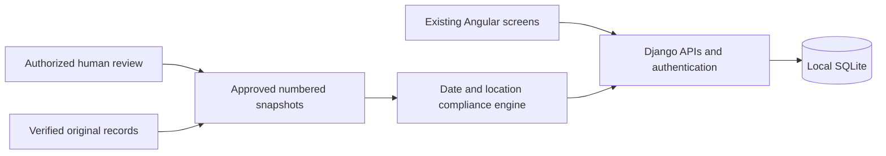

# HuntIt completion report

**Source-link cleanup:** the map-link tracking parameters were removed from the distributed fixtures without changing regulatory content or approval dates. See [SOURCE_LINK_CLEANUP.md](SOURCE_LINK_CLEANUP.md) for compatibility with existing installations.

**Fresh-install startup correction:** See [STARTUP_FIX_REPORT.md](STARTUP_FIX_REPORT.md) for the focused launcher change after the reported connection-refused failure. Wait for `HuntIt is ready` before opening the app; server logs now identify startup failures. Approved data and application features are unchanged.

**Current data update:** See [DATA_UPDATE_REPORT.md](DATA_UPDATE_REPORT.md) for the October 12 four-species data completion, four-WMA expansion and Fisheating python correction. The project owner checked the sources and separately approved local publication: **“Sources checked — approve local publication.”** The 40 new scopes and 18 revisions now form an exact frozen approved release; setup reproduces 58 current curated publications, preserves 18 prior revisions and includes the original-data publication. The earlier approvals retain their regulatory content and original approval dates. Post-publication QA passed 229 Django and 64 Angular tests, plus 782 API boundary requests, build/schema checks and live browser checks; the then-current 212-file ZIP and fresh-install checks also passed, as recorded in [QA_REPORT.md](QA_REPORT.md). Those results precede the launcher correction linked above. Nothing was committed or pushed. The sections below document the underlying integration and earlier approved-data work.

The combined `HuntIt-integrated` project connects the original Angular frontend and Django backend and completes the account, personal-data and regulation-search workflows described in the SDS. The original ZIPs and earlier project copies remain available. Nothing was committed or pushed.

## Accounts, storage and local hosting

| Component | What was added | What it does for the team |
|---|---|---|
| SQLite schema | `backend/personal/models.py` and migrations: preferences, license statuses, saved-search inputs, harvest records and archive dates. Foreign keys reuse the existing species/location tables. | Each account has its own persistent information; accounts cannot read or change another user's records through the API. |
| Django authentication | `backend/accounts/`: registration, login/logout, sessions, current user, CSRF protection, validation, throttling and password change. | Passwords are hashed. Hunters change them in **Account & Data Settings** using their current password; other sessions are revoked. |
| Account administration | Hardened Django User admin and tests. | Authorized admins reset forgotten passwords, suspend/reactivate users, or delete accounts with confirmation. Suspension preserves records. Account deletion removes personal records; published regulatory history survives. Only superusers grant elevated access. |
| Local hosting | `scripts/setup_local.py`, `scripts/run_local.py`, proxy/settings changes and clean release packaging. | Setup creates a local SQLite file automatically. The default launcher serves browser traffic over HTTPS; a trusted local certificate can be supplied. No database server, shared admin password or shared secret is required. Python, Node and dependency installation are still needed. |

The ZIP shares migrations and clean starter data instead of a live SQLite database containing users. Every teammate gets an independent database; their later records do not synchronize automatically.

## Integration with the existing code

| Existing foundation | Necessary additions or changes | What was preserved |
|---|---|---|
| Original Angular pages | Connected Home/Results to real APIs; added required date/location filters and current source dates. Connected Profile, Licenses and Harvest Log to persistent records, plus saved-search, password, export and reset controls. Added guards, loading/error messages, account-change cleanup, keyboard support and small mobile fixes. | Original page structure, artwork and visual identity. Prototype samples were replaced where real data was necessary. Only Home CSS needed a narrow-screen fix. |
| Original Django project | Added read-only public APIs and the separate `integration` app for the compliance engine, review drafts and immutable approved publications. Added permission/ownership checks, privacy headers and query-log redaction. | Regulatory models/importer remain the foundation; original migrations `0001`–`0009` and dependency versions remain. |
| Confirmed defects | Fixed the admin's renamed managed-area search field, inconsistent date/bag records, parser assumptions about python-area counts and hog bag-limit wording, stale search/account responses, and narrow-screen land-selector overflow. | No wholesale backend or frontend rewrite. The exact original-file differences are in [CHANGE_MANIFEST.json](CHANGE_MANIFEST.json). |

The current byte-for-byte comparison with the supplied ZIPs is recorded in [CHANGE_MANIFEST.json](CHANGE_MANIFEST.json). No original source file was removed. The original image pixels, the Angular lockfile, the backend requirements file and original migrations are preserved. Image metadata in the current distribution may differ after presentation-only cleanup. The backend is relocated under `backend/`.

The regulation engine evaluates species, land type, date and applicable zone/DMU/managed area. It distinguishes reviewed matches, closed seasons, missing inputs, unpublished drafts and unsupported coverage. Saved searches keep inputs and rerun against current approved publications. Editing/importing source data cannot silently change a published answer.

## Regulatory data and human approval

The original 18 curated FWC rule sets are preserved as prior immutable revisions: one private-land hog scope, three python scopes, twelve private-land deer DMUs and two selector variants for J.W. Corbett. The project owner approved these on **2026-10-12**, then confirmed that all existing teammate information had been verified and requested its inclusion in search. A separate frozen, hash-checked approved copy of **all 292 original records** was added, preserving **102 seasons, 78 date periods, 14 bag-limit rules, 5 regulatory notes and the reference/species records**. The approval records the exact owner statement and date. It does not establish a new independent audit of every imported claim. The later approved expansion replaces the 18 current curated answers with reviewed revisions and adds 40 scopes; it does not rewrite those original releases or history.

Search results now include the existing matching seasons, bag limits, exceptions and notes under **Additional Verified Project Records**, with their official sources, original retrieval dates and the owner verification date. **Private-land turkey searches now work** for their recorded fall zones and spring/youth regions north or south of SR70. Existing habitat, behavior and hunting tactics are shown from the approved copy. The turkey fall/spring limit association was corrected so archery/crossbow and youth searches receive the appropriate limits, and WMA hog advisories were preserved as area guidance rather than private-land rules or evidence of an open season.

Original dates and blanks in the frozen teammate copy were not filled with guesses. Newly reviewed publications now supply the missing turkey requirements and profile; closed dates remain closed, and undated year-round labels do not extend the curated publications' explicit coverage. The raw teammate tables and original 18 publication histories were not overwritten. Later imports and live edits cannot change approved search content automatically. Admins can withdraw publications; repeated setup preserves withdrawals. [REGULATORY_REVIEW.md](REGULATORY_REVIEW.md) describes the separate approvals and their scope, and [DATA_EXPANSION_APPROVAL.md](DATA_EXPANSION_APPROVAL.md) pins the newly approved expansion.

This data update adds `backend/integration/legacy_release.py`, `legacy_search.py`, the approved fixture, migration `0003` and regression tests. Narrow changes to the existing integration engine, catalog, setup and admin connect that snapshot to searches. Angular changes are confined to Results and its API types/tests; no original artwork or stylesheet was changed in this update. A source-date display bug was also fixed so UTC dates do not shift to the previous day in US timezones.

## Saved information and recovery

Hunters can update preferences and license statuses, rename/delete saved searches, and edit harvests. Settings provides a private JSON export and an explicitly confirmed selective reset. Harvest reset **archives** records, which can be restored; permanent deletion is a separate confirmed action. This retains useful season history and supports correcting mistakes. Preferences and obsolete search/license records can be cleared when no longer useful. HuntIt's harvest log does not replace official FWC reporting, and license statuses remain self-reported.

## Verification and delivery

See [QA_REPORT.md](QA_REPORT.md) for final automated counts, browser checks, HTTPS verification, fresh-install/package checks and the SDS story matrix. QA uses disposable accounts/data excluded from the ZIP. Two original CSS size warnings remain; the production build succeeds.

The working folder's database was backed up before release changes. The original regulatory catalog, original-data snapshot and 18 prior curated revisions were preserved. The local database and its backups are excluded from the ZIP; setup creates each teammate's independent SQLite database and installs all three exact approved releases without accounts or credentials.

Run the project using [INTEGRATION.md](INTEGRATION.md). Continuing operational work is to review future FWC changes, maintain supported coverage and configure any real deployment. Course reports/presentations and collecting every Florida regulation are separate from implementing the listed application stories.
